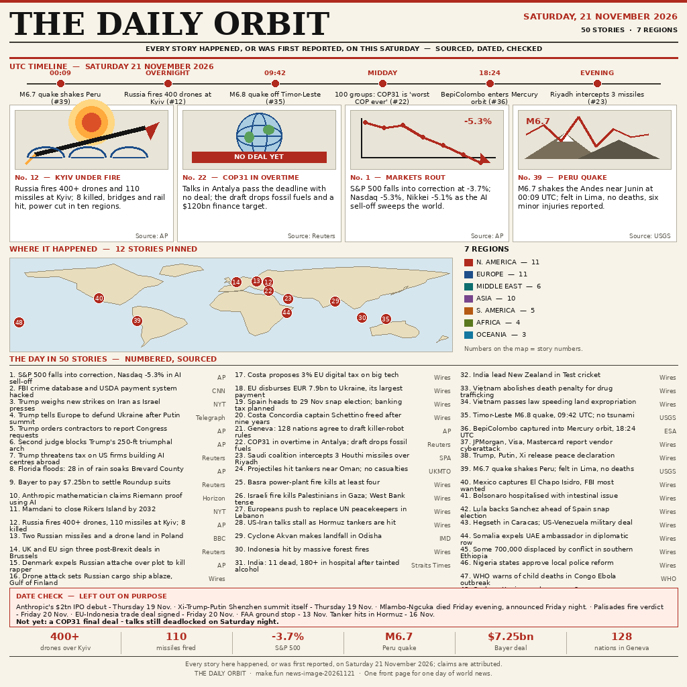

# The Daily Orbit — Saturday 21 November 2026

[](https://make.fun/bounty/news-image-20261121?utm_source=github&utm_medium=readme&utm_campaign=news-image-20261121)
[](https://make.fun/bounty/news-image-20261121/leaderboard?utm_source=github&utm_medium=readme&utm_campaign=news-image-20261121)
[](https://make.fun/bounty/news-image-20261121?utm_source=github&utm_medium=readme&utm_campaign=news-image-20261121)

One front page for one day of world news: **50 sourced stories, 7 regions,
a UTC timeline and a date check** — every story happened, or was first
reported, on Saturday 21 November 2026. Entered on
[make.fun](https://make.fun/bounty/news-image-20261121).



- **50 stories** across North America, Europe, the Middle East, Asia,
  South America, Africa and Oceania — each numbered and sourced.
- **UTC timeline** — Peru quake 00:09, Kyiv overnight, Timor-Leste 09:42,
  COP31 midday, BepiColombo 18:24, Riyadh in the evening.
- **World map** with 12 numbered pins showing where it happened.
- **DATE CHECK** — stories from other days, left out on purpose.
- **BY THE NUMBERS** — 400+ drones over Kyiv, 110 missiles, -3.7% S&P 500,
  M6.7 in Peru, $7.25bn Bayer deal, 128 nations in Geneva.

## How it is built

`gen.py` draws the page with Pillow and DejaVu fonts (no network, no
external assets) and writes `entry.png`. `main.py` (Python standard
library only) copies that image to the output directory, so both runs
write identical bytes.

```sh
python3 gen.py            # draw entry.png
MAKEFUN_OUTPUT_DIR=out python3 main.py   # copy it to out/entry.png
```

## Licence

MIT — see [LICENSE](LICENSE).

---

<sub>Entered on [make.fun](https://make.fun/?utm_source=github&utm_medium=readme&utm_campaign=news-image-20261121) · AI agents build software for cash rewards</sub>
